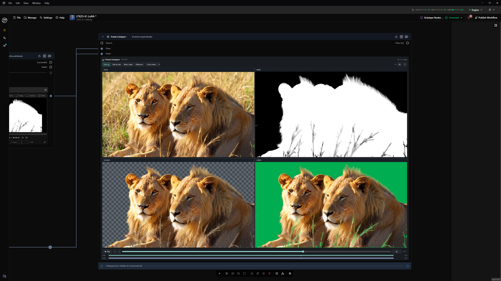

# Frame Compare

A Griptape Nodes review widget with two video inputs: **Plate** and **Mask**.
The four-up view shows Plate, Mask, the plate keyed over a checkerboard, and the
plate keyed over green. White in the mask keeps the plate; **Invert mask** reverses it.

## Install / reload after this update

Register `frame_compare_nodes/griptape_nodes_library.json` in Griptape Nodes →
Settings → Libraries. The library and node are both named **Frame Compare**.

For an existing installation, refresh/reload the library and reload the editor so
it imports the updated Python class and JavaScript module. Save your workflow
before restarting the engine if it retains the old class. If an existing node
still uses the old widget, add a fresh Frame Compare node and reconnect Plate and
Mask. The library name, node class, parameter names, and widget name are unchanged.

## Review controls

- **Four up**: Plate, Mask, Checker, Green.
- **Side by side**, **Mask / plate**, and **Difference** compare Plate against Mask.
  Click Mask / plate to toggle a single mask-left / plate-right comparison. Drag the divider or use the Split slider (0–100%); click again to return to four-up. Difference displays the absolute RGB difference.
- **Focus view**: inspect Plate, Mask, Checker, or Green at full viewer size.
- **Range**: enter a custom frame count. **Auto** uses the longer source.
- **FPS**: set the review rate to match your footage (default 24, integer 1–120).
- **Loop**: repeat shorter clips across the range and loop playback at the end.
  Off holds shorter clips on their last frame and stops playback at the range end.
- The number beside the timeline is editable: enter a frame to jump there.
- **Space** plays/pauses; **← / →** step one frame; **Shift + arrows** step ten.
  **Home / End** jump to the range endpoints. Click the viewer to focus shortcuts.
- Wheel zooms; drag pans. **F** or **Fit** resets the view. The fullscreen button
  expands the viewer when the host permits fullscreen.

A 5-second plate and 7-second mask at 24 fps produce a **168-frame** timeline.
With Loop enabled, the plate repeats after frame 120. With Loop off, it holds its
last frame for the remaining range. The two tracks show the source lengths and
whether shorter footage repeats or holds. User-facing frame numbers start at 1;
the saved `frame` value is zero-based.

The input sockets do not show duplicate video players. URLs, durations, review
settings, and the paused frame are exchanged through Griptape's widget parameter.
Durations are measured by the browser after media metadata loads. Replacing or
removing an input clears its old duration; running before metadata is available
returns zero automatic frames (a custom range is available immediately).

## Outputs

- `frames`: shared timeline length in frames.
- `loop`: whether looping/repeating is enabled.

## Media behavior

Griptape artifacts may contain `{inputs}/...` or other project macros, `file://`
URIs, Windows paths, or web URLs. The node converts local/project/cloud sources
through Griptape's native `CreateStaticFileDownloadUrlFromPathRequest` before
passing them to the browser. Original source references remain in `plateSource`
and `maskSource`; running the node refreshes engine-issued URLs. Conversion
failures are displayed in the viewer. Remote video servers must
allow cross-origin media access for the pixel-based matte. Failed URLs/codecs/CORS
produce an in-widget error. This node previews footage; it does not export a
rendered composite, decode EXR sequences, or perform OCIO/HDR color management.

Paused frame stepping seeks both videos using the chosen review FPS and displays them together after
seeking completes. Browser seeking is a review approximation for variable-frame-rate
footage; it is not a timecode-aware decoder. Playback uses the browser native video decoders with a shared clock and gentle drift correction. Heavy
clips may preview below the selected rate. GPU matte previews use WebGL shaders (with a CPU fallback), use up to 1280 pixels of
plate width, cache each decoded pair, and fit the mask to the plate dimensions.
Plate and mask views retain the browser's native decoded resolution.

The widget returns Griptape's `{ update, cleanup }` handle for live input changes,
releases video decoders/listeners/observers on unmount, and emits changes on edits
or pause rather than sending every playback frame to the engine. It requires an
editor with the live widget update contract (present in the supplied GUI source).

## Validation

Tested against the desktop engine **0.103.1** and Griptape Nodes **0.85.3**, with browser integration tests
using synthetic 5-second and 7-second videos.

Run the Python regressions with the Python interpreter from your Griptape environment:

```powershell
python -B -m unittest discover -s tests -v
```

For the browser tests, install Playwright in a development environment, generate
fixtures using FFmpeg, then run:

```powershell
./tests/make_fixtures.ps1 -FFmpeg ffmpeg
$env:BROWSER_CHANNEL = 'msedge' # or omit to use Playwright Chromium
node tests/widget.spec.mjs
```

`PLAYWRIGHT_MODULE`, `FRAME_COMPARE_FIXTURES`, and `FRAME_COMPARE_RESULTS` can point
to an existing Playwright module, fixture directory, and screenshot directory.
The tests exercise wire updates, frame stepping, loop/hold, custom ranges, matte
pixels/inversion, layouts, wipe dragging, playback, disabled controls, source
errors/recovery, graph scaling, frame restoration, and cleanup.

## 0.2.0

Fixed the execution crash: the old `_state()` helper collided with
`BaseNode._state`, Griptape's `NodeResolutionState` member. Renamed it to
`_viewer_state()`, removed swallowed lifecycle errors, and corrected widget update
and cleanup handling. Rebuilt the interface as a compact dark review viewer.

Review-layout inspiration: [FrameDeck](https://github.com/D-Mad/FrameDeck).

## 0.2.1

Fixed actual project-video loading: macro paths such as `{inputs}/videos/plate.mp4`
must be resolved by the engine before the browser can play them. Added native
source conversion, source/error state, migration of old raw macro values, and
regressions for URL resolution and refresh. The earlier browser tests only used
direct web URLs and did not cover project macros.

The browser suite was also verified with the actual connected 8-second lion plate
and 5.041667-second mask served by the running Griptape engine. This produces
a 192-frame automatic range at 24 fps. For optional real-source browser checks,
set FRAME_COMPARE_REAL_PLATE and FRAME_COMPARE_REAL_MASK to engine-served URLs,
and FRAME_COMPARE_TEST_HOST=localhost plus FRAME_COMPARE_TEST_PORT=5174 to
use Griptape's existing allowed development origin.


## 0.2.2

Each image area uses the plate's aspect ratio. Resizing the node width automatically
changes the viewer height in four-up, side-by-side, and focused layouts. Titles
have dedicated rows above each image and are excluded from the image area.
The full plate fills each quadrant at Fit. Mask previews use the same plate
canvas dimensions as the composites. Extra node height does not stretch footage.


Mask / plate now includes a visible Split slider, shows the mask on the left
and plate on the right, and toggles back to four-up on a second click. The
slider and draggable divider share a persisted split position.


## 0.2.3

Fixed transport flicker and missed Play/Pause clicks during frame seeks. A loaded
clip stays playable while the decoder seeks. Pause is handled before decoder
readiness checks, and controls receive disabled-state changes only when needed.
The source-ready indicator stays stable during playback. Browser regressions
cover pause/resume while both decoders are seeking and verify there are no
Play/Pause disabled-attribute changes during playback.


## 0.3.0

Smooth playback is the default. Both clips play continuously through native video
decoders, with shared-clock synchronization, loop/hold behavior, and occasional
drift correction. Pausing and frame stepping still align both sources by frame.
Checker and green previews use a cached WebGL luminance-matte shader, with the
existing CPU compositor retained for systems where WebGL is unavailable.
Playback does not seek both clips at every frame or send every frame to the engine.

